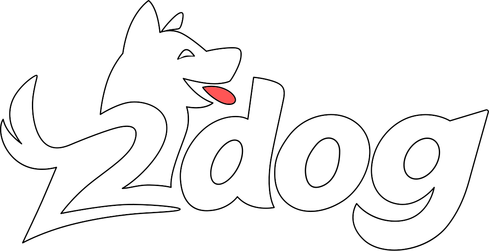

<p align="center">
  
</p>

[](https://discord.gg/GAXdbZCNGT)
[](https://www.nuget.org/packages/2dog/)
[](https://github.com/outfox/2dog/actions/workflows/ci.yml)

# 🦴 2dog is Godot... just backward!

### Godot normally loads .NET, now .NET loads Godot.

**2dog** is available fully precompiled from [NuGet.org](https://www.nuget.org/packages/2dog/) and as [GitHub Releases](https://github.com/outfox/2dog/releases). *(no need to clone this repo)*

**2dog** packages Godot as a library (a slightly modified [`libgodot`](https://github.com/godotengine/godot/pull/110863))
that your .NET application hosts. Keep your Godot project exactly as it is, and run it on the desktop, in the
browser, inside a .NET UI, or under **xUnit and NUnit with a real Godot engine**, all with `dotnet` and your IDE.

📖 End-user documentation: **[2dog.dev](https://2dog.dev)**

## Build and develop locally

Poe is the build entry point; tasks live in [pyproject.toml](pyproject.toml).
`uv run --locked` installs the Python tools from `uv.lock`; [global.json](global.json)
pins the .NET SDK and optional workload set. Install **uv**, **Git LFS**, that .NET SDK,
and your platform's [Godot build dependencies](https://docs.godotengine.org/en/stable/engine_details/development/compiling/index.html).
Configuration checks and releases also need [Nushell](https://www.nushell.sh/).
Configure GitHub SSH access for the Godot submodule before cloning.

On Windows, enable [Developer Mode](https://learn.microsoft.com/windows/advanced-settings/developer-mode)
and run `git config --global core.symlinks true` before cloning.

```bash
git clone --recursive https://github.com/outfox/2dog
cd 2dog
git lfs pull
uv run --locked poe build-all
```

`build-all` builds the host's Godot editor, C# glue and native libraries, then packs
platform packages, bindings, the engine and integrations in dependency order. Packages
land in `packages/`, and the desktop/test solution filter is restored last.

| Command | When to use it |
| --- | --- |
| `uv run --locked poe build-local` | Incremental native work after a full build of the same precision; skips the editor and glue, then repacks. |
| `uv run --locked poe build` | Repack platform and managed packages from existing native outputs. Unbuilt platforms get empty stubs. |
| `uv run --locked poe build-managed` | Repack bindings, engine and integrations using existing platform packages; no C++ build. |

Add `--precision double` to these build tasks for matching double-precision natives
and managed packages. Direct `dotnet` commands then need `-p:TwoDogPrecision=double`.
Native build options go after `--`; for example, to keep an SCons cache and debug symbols:

```bash
uv run --locked poe build-all -- --cache-path temp/scons-cache --debug-symbols yes
```

For managed work without compiling Godot, use
`uv run --locked poe pull-packages --run RUN_ID` with an authenticated GitHub CLI (`gh`).
Replace `RUN_ID` with a successful CI run matching the checkout's Godot pin and package
versions; add `--precision double` if needed. This imports validated packages and matching
SDK/bindings, records CI package versions and restores the desktop/test solution.
After importing, use `build-managed` or direct `dotnet` commands to keep the downloaded
platform packages. Run CI again if its package artifacts have expired.

```bash
dotnet run --project demos/showcase/showcase.2dog
dotnet test 2dog.tests.slnf
uv run --locked poe test-build-configuration
```

Install optional workloads with `uv run --locked poe install-workloads wasm-tools`
(substitute `android` or `ios maui-ios` as needed), using the committed workload-set pin.
`uv run --locked poe --help` lists the mobile build tasks and other commands.

## Release

After changing the Godot submodule, run `uv run --locked poe sync-versions` and commit
its version/pin updates with the submodule bump. This sync does not create a release.
Then release from a clean, up-to-date `main` checkout with Git signing and push access
to both this repository and the Godot fork:

```bash
uv run --locked poe release --dry-run       # preview versions and pushes
uv run --locked poe release                 # release the line in main (currently 4.8)
uv run --locked poe release --line 4.7      # release another configured Godot line
```

The default release signs a version-bump commit and atomically pushes `main` and its tag.
With `--line`, only the other line's tag is pushed; its release commit stays off `main`.
[godot-lines.json](godot-lines.json) defines those lines. All lines share one release
counter; native package revisions are reused while their input fingerprints match.

CI calls the same Poe recipes, reuses verified native builds by input fingerprint,
and uses Blacksmith caches and sticky disks. It tests both precisions, stages a complete
package set on a GitHub prerelease, and uploads it to **int.nugettest.org**. The independent
iOS Release/AOT check runs after staging alongside upload; production promotion requires
it to pass. Promote the staged packages with an authenticated GitHub CLI, replacing `TAG`:

```bash
gh workflow run publish.yml -f tag=TAG -f feed=nuget
```

For CI on another line without releasing, run
`uv run --locked poe release --ci --line 4.7`; delete its temporary `ci/4.7/<commit>`
branch after the run.

## Dogs and robots are nice

🦴♥️👾 **2dog** is proudly made by human maintainers and contributors. We permit extensive use of LLMs:

- Forked `libgodot` features/fixes consist of similar amounts of human-written and machine-written code
- Commits/PRs are reviewed & gated by both humans and machines (over 90%/90%) and signed by humans
- .NET Host applications are mostly human-written, while boilerplate assets (e.g. XAML) are mostly machine-written
- Configurations, tools, smoke tests, CSS, MSBuild XML, and CI workflows are overwhelmingly LLM-maintained
- Documentation aims to be human-authored, but new feature docs are generated and later gradually rewritten
- Releases on NuGet use Trusted Publishing and may only be invoked via direct human interaction

## Acknowledgements

Continuous Integration compute graciously supported by [Blacksmith](https://blacksmith.sh).
