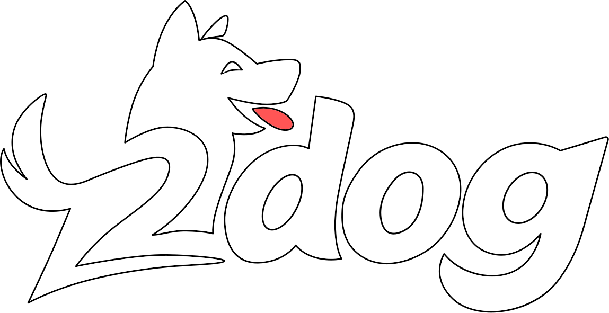

<p align="center">
  
</p>

[](https://discord.gg/GAXdbZCNGT)
[](https://www.nuget.org/packages/2dog/)
[](https://github.com/outfox/2dog/actions/workflows/ci.yml)

# 🦴 2dog is Godot... just backward!

### Godot normally loads .NET, now .NET loads Godot.

**2dog** is available fully precompiled from [NuGet.org](https://www.nuget.org/packages/2dog/) and as [GitHub Releases](https://github.com/outfox/2dog/releases). *(no need to clone this repo)*

**2dog** packages Godot as a library (a slightly modified [`libgodot`](https://github.com/godotengine/godot/pull/110863))
that your .NET application hosts. Keep your Godot project exactly as it is, and run it on the desktop, in the
browser, inside a .NET UI, or under **xUnit and NUnit with a real Godot engine**, all with `dotnet` and your IDE.

📖 Full documentation: **[2dog.dev](https://2dog.dev)**


## Experimental WebGPU

Single-precision Windows, Linux and macOS packages include native Dawn/WebGPU.
Single-threaded browser packages include WebGPU alongside WebGL. Existing
renderer defaults are preserved. Select the Mobile renderer with:

```text
--rendering-driver webgpu --rendering-method mobile
```

Forward+, Android, double precision and threaded browser runtimes do not support
this experimental driver. Unsupported selections fail with a runtime-specific
error. See [build configurations](docs/content/build-configurations.md#experimental-webgpu)
for browser setup, adapter limitations and source builds.

## Features

- **Your Godot project stays yours.** Scenes, scripts and assets stay where they are; keep editing them in the
  official Godot .NET editor.
- **Godot C# on the web.** `dotnet publish` your C# game to WebAssembly, with optional WebXR and experimental
  multithreading. [More](https://2dog.dev/hosts/web)
- **Real-engine tests.** xUnit and NUnit fixtures run headless in CI, with Godot-aware assertions for signals,
  frames and deferred deletion; Godot errors fail tests. GDScript tests run through gdUnit.
  [More](https://2dog.dev/testing)
- **Godot inside .NET UIs.** Embed the engine in Avalonia, Blazor, Qt Quick, WinForms, WinUI 3 or MAUI, with
  native controls over the game.
- **A C# REPL in your running game.** Inspect and change live nodes from a terminal or a coding agent.
- **One tool for setup and upkeep.** `2dog new`, `add`, `doctor` and `update` scaffold hosts, diagnose build
  problems and keep package versions in step. [More](https://2dog.dev/dnx-2dog)
- **No engine compile.** Prebuilt natives for Windows, Linux, macOS, WebAssembly and Android come from NuGet.
- **Automatic import.** Changed resources are imported during the build; no `godot --import` step.
- **Plain .NET projects.** Each host is a normal project in your solution: build, debug and publish it like any
  other, including self-contained and NativeAOT desktop builds.

### Hosts

The tool adds each host as a small nested project with its own .NET entry point:

| Host | What it does | `2dog add` flag |
| --- | --- | --- |
| [Desktop](https://2dog.dev/hosts/generic) | Run Godot from your own `Main` on Windows, Linux and macOS. | `--generic` |
| [Web](https://2dog.dev/hosts/web) | Publish your Godot C# game to the browser. | `--web` |
| [WebXR](https://2dog.dev/hosts/webxr) | Take your game into browser VR and AR. | `--webxr` |
| [Avalonia](https://2dog.dev/hosts/avalonia) | Embed Godot in a cross-platform desktop UI. | `--avalonia` |
| [Blazor](https://2dog.dev/hosts/blazor) | Put Godot in a Blazor page and drive it from Razor components. | `--blazor` |
| [Qt Quick](https://2dog.dev/hosts/qt) · experimental | Embed Godot in a QML app built with Qt Bridge for C#. | `--qt` |
| [WinForms](https://2dog.dev/hosts/winforms) | Embed Godot in a Windows Forms application. | `--winforms` |
| [WinUI 3](https://2dog.dev/hosts/winui) | Embed Godot in a Windows App SDK application. | `--winui` |
| [MAUI](https://2dog.dev/hosts/maui) | Embed Godot in a MAUI page on Windows or Android. | `--maui` |
| [Android](https://2dog.dev/hosts/android) · experimental | Build an APK with `dotnet publish`. | `--android` |
| [xUnit](https://2dog.dev/hosts/xunit) | Test your game with xUnit. | `--xunit` |
| [NUnit](https://2dog.dev/hosts/nunit) | Test your game with NUnit. | `--nunit` |
| [gdUnit](https://2dog.dev/hosts/gdunit) | Run GDScript gdUnit tests with `dotnet test`. | `--gdunit` |
| [C# REPL](https://2dog.dev/hosts/repl) | Explore and change your running game from a prompt. | `--repl` |

The [showcase](demos/showcase/README.md) runs one Godot project across desktop, web, UI and Android hosts.


## Getting started

You need the [.NET 10 SDK](https://dotnet.microsoft.com/download). The Godot editor is optional and only needed
to edit scenes visually.

**Existing Godot project:** from the folder with `project.godot`, pick hosts and run the desktop one.

```bash
cd path/to/MyGame
dnx 2dog add
dotnet run --project MyGame.2dog
```

**New project:**

```bash
dnx 2dog new MyGame
cd MyGame
dotnet run --project MyGame.2dog
```

`MyGame` stands for your project's name. Run `dnx 2dog add` again at any time to add another host, for example:

```bash
dnx 2dog add --web --xunit
dotnet publish MyGame.web     # game and index.html land in MyGame.web/AppBundle/
dotnet test MyGame.xunit
```

Each host is a nested folder that Godot ignores, so your project looks like this:

```text
MyGame/
├── project.godot      your scenes, scripts and assets, unchanged
├── MyGame.csproj      your Godot C# game
├── MyGame.slnx
├── MyGame.2dog/       desktop host
├── MyGame.web/        browser host
└── MyGame.xunit/      tests
```

Continue with the [getting started guide](https://2dog.dev/getting-started), then the page for each host you added.
Later, `dnx 2dog update` moves the project to new 2dog releases and `dnx 2dog doctor` finds and fixes problems.


## Requirements and status

- .NET SDK 10.0 or later on `win-x64`, `linux-x64` or `osx-arm64`
- Godot 4.7, with the official .NET editor for visual editing
- Published builds: `win-x64`, `linux-x64`, `osx-arm64` and `browser-wasm`; Android arm64/x64 and iOS device/Simulator arm64 are experimental
- Web, WebXR and Blazor hosts need the `wasm-tools` workload; Android needs the `android` workload, the Android SDK
  and JDK 17. iOS needs the `ios` workload and a Mac with Xcode. `2dog` offers to install the workloads, and desktop and test builds need neither.

Packages are on [NuGet](https://www.nuget.org/packages/2dog) and [GitHub](https://github.com/outfox/2dog/releases).
The main ones are [`2dog`](twodog/README.md) (the tool), [`2dog.templates`](templates/README.md)
(the `dotnet new` templates) and [`2dog.engine`](twodog.engine/README.md) (the library); the tool adds the rest to your hosts.

Experimental iOS support: `dnx 2dog add --ios` scaffolds a host that shows Godot's view
controller; it builds on a Mac with Xcode (`dotnet build -r iossimulator-arm64` for the Simulator).
See the [iOS host](https://2dog.dev/hosts/ios) and [2dog.ios](twodog.ios/README.md).


## Dogs and robots are nice

🦴♥️👾 **2dog** is proudly made by human maintainers and contributors. We permit extensive use of LLMs:
- Forked `libgodot` features/fixes consist of similar amounts of human-written and machine-written code
- Commits/PRs are reviewed & gated by both humans and machines (over 90%/90%) and signed by humans
- .NET Host applications are mostly human-written, while boilerplate assets (e.g. XAML) are mostly machine-written
- Configurations, tools, smoke tests, CSS, MSBuild XML, and CI workflows are overwhelmingly LLM-maintained
- Documentation aims to be human-authored, but new feature docs are generated and later gradually rewritten
- Releases on NuGet use Trusted Publishing and may only be invoked via direct human interaction


## Compile your own: Teach 2dog new tricks (Contributors)

Want to contribute, modify, or add to 2dog itself? Clone with submodules, then build the native and .NET packages:

```bash
git clone --recursive https://github.com/outfox/2dog
cd 2dog
uv run poe build-all
```

Run the showcase with `dotnet run --project demos/showcase/showcase.2dog` and the tests with
`dotnet test twodog.tests`. 

The repository contains symlinks. On Windows, enable
[Developer Mode](https://learn.microsoft.com/windows/advanced-settings/developer-mode)
and run `git config --global core.symlinks true` before cloning. To repair an
existing clone, run `git config core.symlinks true`, then
`git checkout -- demos/showcase/fps_counter.tscn`.


## Acknowledgements

Continuous Integration compute graciously supported by [Blacksmith](https://blacksmith.sh).


## Join us at the dog park

We have a dedicated channel for 2dog. Come say hello!

[](https://discord.gg/GAXdbZCNGT)

---

### *No squirrels were harmed in the making of this README.*
